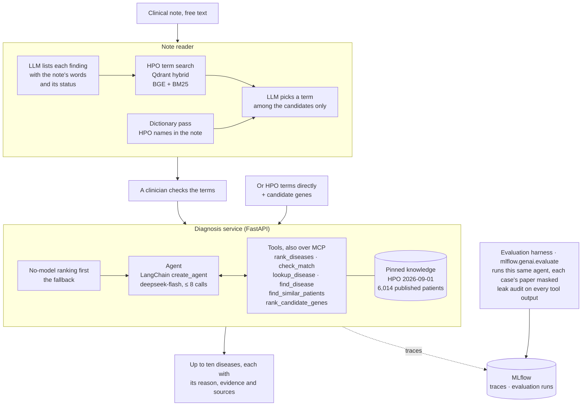
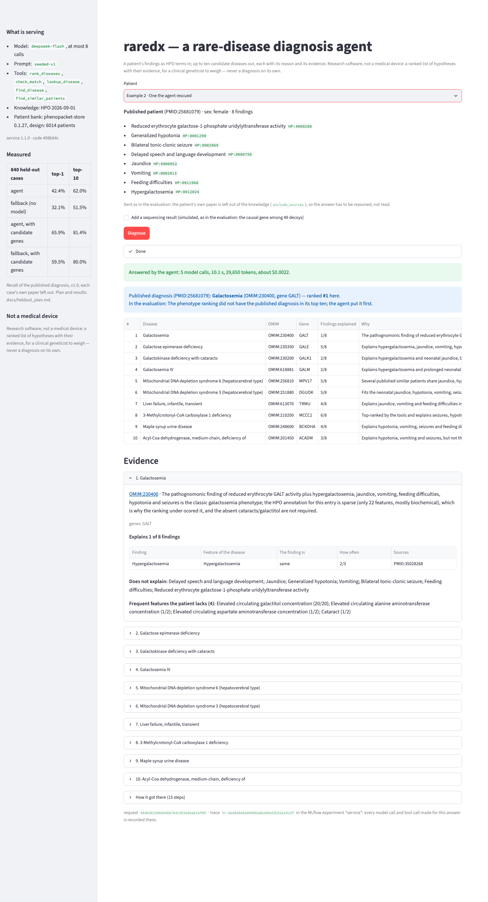

# raredx — rare-disease diagnosis agent

[](https://github.com/pipi0616/rare-disease-agent/actions/workflows/ci.yml)

An agent that takes a patient's clinical findings (free text or HPO terms,
optionally with candidate variants), decides what to look up, and returns
ranked candidate diseases and genes with cited evidence. Evaluated on public,
leakage-controlled case collections against classical, fixed-pipeline and
single-call baselines.

**Status:** the agent, evaluated on a held-out set and served over HTTP, with seven tools and the baselines it is measured against. Tools:
`rank_diseases` (every OMIM disease ranked against the patient's phenotype),
`lookup_disease` (one disease's features with their frequencies, inheritance,
onset, genes and sources, sized for a model to read), `check_match` (the
patient's findings against one disease: explained, unexplained, contradicted,
and the disease's frequent features the patient lacks), `find_disease` (a
disease's OMIM id from its name), `find_similar_patients` (the published
patients whose phenotype is closest, with their confirmed diagnoses) and
`search_disease_texts` (Orphanet and MedlinePlus descriptions, hybrid
retrieval, each passage with its source), and, when the patient has been
sequenced, `rank_candidate_genes` (candidate genes ranked by how well their
diseases match the phenotype). The agent gets the four core tools and
`find_similar_patients` (and `rank_candidate_genes` with sequencing data);
the text search, which the ablation found worth nothing, is served over MCP
and given to the agent only with `--with-texts`.

**How the parts fit.** A note is read into HPO terms (`/v1/terms/from-note`), a
person checks them, and the codes go to the diagnosis service (`/v1/diagnose`),
which ranks diseases without a model first — its answer if the model fails — and
then lets the agent investigate with its tools. Every request is one MLflow trace,
and the evaluation harness runs the very agent the service serves, with each case's
own paper masked from its knowledge.



**Held-out result (v1.0).** One case from each of 840 papers that share no
paper with anything used in development; one run per system, on a tagged
version, under a plan committed beforehand (`docs/heldout_plan.md`). Recall
of the confirmed disease, 95% intervals:

| system | top-1 | top-10 |
|---|---|---|
| **final agent** | **42.4%** [39.1–45.8] | **62.0%** [58.7–65.2] |
| fixed pipeline | 36.8% [33.6–40.1] | 51.5% [48.2–54.9] |
| rank, then check (no model) | 32.1% [29.1–35.4] | 51.5% [48.2–54.9] |
| nearest published patients (no model) | 27.9% [24.9–31.0] | 50.2% [46.9–53.6] |
| phenotype similarity alone (no model) | 17.5% [15.1–20.2] | 44.4% [41.1–47.8] |
| a single call to `deepseek-flash`, no tools | 14.3% [12.1–16.8] | 29.0% [26.1–32.2] |
| *with simulated sequencing:* **final agent** | **65.9%** [62.6–69.0] | **81.4%** [78.6–83.9] |
| *with simulated sequencing:* gene ranking (no model) | 59.5% [56.1–62.7] | 80.0% [77.1–82.5] |

The pre-registered primary question — is the agent better than the fixed
pipeline at first place — holds: paired on the same cases, 57 to 10
(sign test p = 4 × 10⁻⁹); in the top ten, 94 to 6. With sequencing, 59 to 5
against the gene ranking. All eight runs were valid on the first attempt (no
model-API failures; the leak audit clean over more than 50,000 tool outputs
per agent run), and on the 122 cases strict masking makes unanswerable every
tool-using system scores zero in the top ten, as it should; on the other 718
the agent reaches 49.6% top-1 and 72.6% top-10. I had predicted the lead
would shrink from the dev set's; it did not. Not yet done: comparison with
Exomiser, LIRICAL, general-purpose LLMs and DeepRare on the same cases.

**Against an established tool.** LIRICAL 2.4.1 (Robinson et al. 2020), a
published, maintained phenotype-driven tool, run on the same 840 cases under
the same conditions — the same findings, the same HPO release, and the same
mask, applied by giving it, for each case, its own copy of the annotation
file written under the masking rules — with a plan committed beforehand
(`docs/comparison_plan.md`):

| held-out, 840 cases | top-1 | top-10 |
|---|---|---|
| **final agent** | **42.4%** [39.1–45.8] | **62.0%** [58.7–65.2] |
| LIRICAL | 30.1% [27.1–33.3] | 48.3% [45.0–51.7] |
| LIRICAL, each case's own paper left in the knowledge | 63.2% [59.9–66.4] | 79.4% [76.5–82.0] |

Paired, the agent is right at first place on 121 cases LIRICAL misses, and
LIRICAL on 18 the agent misses. Masked, LIRICAL is level with this project's
strongest no-model baseline (rank, then check: 32.1%), which was therefore no
strawman. Unmasked, every system measured gains over 30 points at top-1 (LIRICAL
+33, 278 cases gained and none lost): for 75% of these published cases HPO's
annotation of the disease cites the patient's own paper, and the whole gain
comes from those — on the other 25% masking changes not one answer. A
benchmark on public case reports that does not mask is about half leakage.
Per-case outcomes: `docs/comparison_hits.tsv`.

**Against frontier models asked directly.** Each provider's current model,
asked once per case with the same prompt as the single-call baseline, through
OpenRouter, on a fixed random 200 of the 840 held-out cases
(`docs/comparison_plan_llms.md`):

| held-out, 200 cases | top-1 | top-10 |
|---|---|---|
| **final agent** (`deepseek-flash` with tools) | **43.0%** [36.3–49.9] | **60.5%** [53.6–67.0] |
| GPT-6.1, asked directly | 33.0% [26.9–39.8] | 49.0% [42.2–55.9] |
| LIRICAL | 28.0% [22.2–34.6] | 47.0% [40.2–53.9] |
| Gemini 4, asked directly | 27.0% [21.3–33.5] | 42.0% [35.4–48.9] |
| Claude Sonnet 5.5, asked directly | 23.5% [18.2–29.8] | 38.5% [32.0–45.4] |
| `deepseek-flash`, asked directly | 15.0% [10.7–20.6] | 25.5% [20.0–32.0] |

Paired at first place the agent wins against each: 37 to 17 (GPT-6.1,
p = 0.009), 52 to 13 and 46 to 14. The model inside the agent scores 15% on its
own; the tools and the workflow take it past every frontier model, at a lower
cost per case. Every billed run carries a per-call spending cap; two runs that
lost cases to the provider (a new account's rate limit, dropped connections)
were completed by asking only those cases again (`--fill-in`). Per-case
outcomes: `docs/comparison_llm_hits.tsv`.

**By how rare the disease is** (looked at afterwards, not planned; descriptive).
The 840 held-out cases split by Orphanet's prevalence class of the confirmed
disease (`src/raredx/knowledge/prevalence.py`; exact OMIM mappings only), first
place:

| held-out, by prevalence | cases (diseases) | final agent | fixed pipeline | LIRICAL | `deepseek-flash` alone |
|---|---|---|---|---|---|
| 1 in 100,000 or more | 42 (25) | 57.1% | 50.0% | 40.5% | 61.9% |
| 1–9 in 1,000,000 | 66 (12) | 80.3% | 74.2% | 50.0% | 53.0% |
| under 1 in 1,000,000 | 272 (115) | 52.6% | 45.6% | 40.1% | 9.6% |
| not classed by Orphanet | 460 (327) | 29.6% | 25.0% | 20.4% | 7.2% |

The model alone knows the relatively common rare diseases — level with the
agent there — and almost none of the rarest, where the agent with its tools is
right about half the time. Its gain over its own model is in the long tail. The
groups are small and cases cluster by disease, so no test is made of it. Of the
327 unclassed diseases, 290 have no exact Orphanet counterpart at all, and a
quarter of their cases cannot be answered once their own paper is masked.

**Reading a clinical note.** A note is read into HPO terms before it is
diagnosed (`src/raredx/phenotyping/`): the model lists each finding with the
note's own words and whether the patient has it, the note denies it or a relative
has it; it never writes an id — exact names are coded directly, the rest chosen
among candidates a hybrid search over HPO's names and synonyms offers — and a
dictionary pass it checks in context. Tested once, under a plan committed
beforehand (`docs/phenotyping_plan.md`), against hand-annotated public text,
document-level micro F1:

| | ID-68 (68 clinical notes) | GSC-2024 (206 abstracts) |
|---|---|---|
| **this reader** | 71.7% (P 64.7, R 80.3) | **71.5%** |
| a dictionary of HPO names | **72.3%** (P 89.9, R 60.5) | 58.6% |
| the model writing HPO ids itself | 55.3% | 47.3% |
| AutoPCR, published (HPO 2024) | 80.3% | 83.5% |

The pre-registered primary claim — better than both baselines on the clinical
notes — **failed**: paired per note, the reader beats the model writing ids
(58 notes to 5, p < 0.001) but not the dictionary (29 to 38, p = 0.33). On the
abstracts it beats both (122 to 31, 160 to 11). The two trade recall for
precision: looked at afterwards, half of the 347 terms counted against the reader
on ID-68 are findings the annotators did not annotate ("floppy", "IQ was
estimated to be 20-30"), and the dictionary cannot tell a denied finding from a
present one. Which costs a diagnosis more was not measured: no public notes come
with confirmed diagnoses. The service offers the reader's terms for a person to
check, each with the note's words.

During development, on the 200-case dev set
(recall of the confirmed disease, 95% intervals):

| system | top-1 | top-10 |
|---|---|---|
| **final agent**: starts from the fixed pipeline's evidence, then calls its tools as it decides, up to 8 turns | **40.5%** [33.9–47.4] | **58.5%** [51.6–65.1] |
| first agent (four tools, no head start) | 39.0% [32.5–45.9] | 54.0% [47.1–60.8] |
| fixed pipeline: the tools' top 10 with their evidence, ranked by one model call | 35.5% [29.2–42.3] | 54.5% [47.6–61.3] |
| rank, then check: T2's top 30 reordered by findings explained (no model) | 30.5% | 54.5% [47.6–61.3] |
| nearest published patients alone (tool T5, no model) | 29.0% | 46.5% [39.7–53.4] |
| phenotype similarity alone (tool T2, no model) | 19.0% | 49.0% [42.2–55.9] |
| disease texts alone (tool T6, hybrid retrieval, no model) | 8.0% | 17.0% [12.4–22.8] |
| a single call to `deepseek-flash`, no tools | 14.5% | 28.0% [22.2–34.6] |
| floor: the same diseases for every patient | 0.5% | 9.0% |

The phenotype tool scores 82.0% if a case's own source paper is left in its
knowledge: HPO curated many disease annotations from the very papers these
cases come from. Every evaluation therefore masks each case's paper from the
knowledge the tools read; the 49.0% is the masked number.
Masked, 41 of the 200 confirmed diseases have no phenotype left in HPO —
mostly diseases known from that single paper — so phenotype ranking alone
cannot pass about 80% here. How each tool is kept from the answer, and how
every run is audited for it, is written up in `docs/leakage.md`.

The fixed pipeline's gain at first place is paired, not just a higher rate:
on the same 200 cases it was right where rank-then-check was wrong 11 times,
and the reverse once (sign test p = 0.006), for about $0.27 a run.
The final agent's lead over the fixed pipeline is established: paired on the
same 200 cases and masking rules, 12 cases to 2 at first place (sign test
p = 0.013) and 10 to 2 in the top ten (p = 0.039). The first agent's lead was
14 to 7 (p = 0.19), not established. A run costs about $0.55 off-peak (about
49,000 input tokens per case, most of them cached).

An error analysis of the agent's 122 first-place misses, computed from its
traces, found 77 retrieval failures — the right disease never appeared in any
tool output — and 45 judgment failures. The next tools target them, and a
seeded variant (`seeded-agent`) starts from the fixed pipeline's evidence and
fills a short answer list from the tools' order. They were evaluated
together on dev-200 (chapter 20), one ablation run per tool: similar-patient
retrieval was worth about three points at first place (10 cases to 4,
p = 0.18; kept); the text search nothing measurable (4 to 2, p = 0.69) for 18%
more tokens (dropped from the agent). The error analysis repeated on the
final agent shows the bottleneck moved from retrieval (40 -> 23 cases) to
judgment between close relatives (29 -> 46). Three ways of re-judging the
recorded evidence in one call — an evidence table, a review of the agent's
ranking, thinking mode — did not beat the agent's own judgment; with
sequencing data, the final agent ties the no-model gene ranking (62.5% vs
62.0% top-1).

The first of them, nearest published patients, beats the disease ranking at
first place on its own (35 cases to 15 paired, p = 0.007), and the two find
different diseases: either one's top 10 holds the confirmed disease about
half the time, the two together 59.5%. Its bank is the design split, each
case's own paper masked; bank and cases share one curation style, so the
number is likely optimistic for a clinician's free-text findings.

Text retrieval, the second, finds the exact disease far less often (17.0%
top-10; hybrid beat dense, 9.5%, and BM25, 15.5%): descriptions differ little
between subtypes. In the agent it supplies descriptions and citations; the
ablation will say what that is worth.

**Phenotype + genotype, a separate exam.** In the clinic a patient is
sequenced. Phenopacket Store records the causal gene but not the exome, so
`eval run --with-genes` simulates one: the causal gene among 49 decoys drawn
per case (seeded) from known disease genes not linked to the case's
disease, sorted by symbol — genes only, uniform decoys, both stated
simplifications. With that list, ranking the genes by phenotype alone, no
model, gets the confirmed disease first in 62.0% of dev-200 cases and in the
top 10 in 78.5%; the ceiling is 80%, since 40 cases' diseases are known only
from their own paper, whose gene–disease link is masked with it. The agent
alone ties that ranking (62.5%) but is right on different cases, so its
answer is fused with the gene ranking by reciprocal rank (k = 60, untuned):
67.0% top-1 and 78.0% top-10, replayed on the recorded runs — 13 cases to 4
against the agent alone (p = 0.049), 11 to 1 against the gene ranking alone
(p = 0.006). The track is reported apart from the phenotype-only numbers
above, never as a gain.

Findings recorded as absent in a patient are not given to any system: they
count against the right disease more often than a wrong one (14 cases to 9
among dev-200's near misses), because curators tick them off the true
disease's own feature table — a leak, so the loader drops them.

## Run

```bash
uv sync                    # create the environment from uv.lock
uv run raredx data fetch   # download every pinned source into data/raw, verify each sha256
uv run raredx data build   # parse it into data/processed: one case per line
uv run raredx data stats   # 10,374 published cases, 780 OMIM diseases, 699 genes
uv run raredx eval check   # the frozen manifests keep every rule
uv run raredx llm check    # model key and endpoint; costs nothing
uv run raredx eval run --system rank-then-check --split dev-200  # run, score, record in MLflow
uv run raredx eval run --system llm-direct --split ci-20     # the model baseline (billed)
uv run raredx eval runs --split dev-200                      # every recorded run on dev-200
uv run raredx eval compare <run id> <run id>                 # two runs, question by question
uv run raredx eval score <run id>                            # re-score recorded traces, no re-run
uv run mlflow ui --port 5050                                 # browse runs at http://127.0.0.1:5050
uv run raredx data fetch lirical hpo-json && uv run raredx data lirical  # LIRICAL (needs Java 17)
uv run raredx eval run --system lirical --split dev-200      # LIRICAL under the same mask
```

Scoring rules are fixed in `src/raredx/evals/scoring.py`: a disease counts when
its OMIM number matches, a gene when its symbol matches; a case with no answer
is a miss that stays in the denominator; every top-k rate carries a 95% Wilson
interval. Systems only ever see a `Question` (the phenotype), never the answer,
and while a system works on a case, the case's source paper is masked from the
knowledge its tools read (`src/raredx/knowledge/masking.py`).

Evaluation runs on MLflow's native GenAI evaluation (`src/raredx/evals/harness.py`):
each frozen manifest is registered as an MLflow evaluation dataset, the scoring
rules are a code-based `@scorer`, and `mlflow.genai.evaluate` asks the system
about every case in parallel. Every question becomes a trace; every evaluation
is an MLflow run with params (system, manifest checksum, dataset version, code
commit), metrics (top-k means plus Wilson bounds) and those traces. A run whose
answers were not all recorded fails instead of reporting a number. The store is
local SQLite (`mlflow.db` + `mlruns/`, both ignored by git); pointing
`RAREDX_MLFLOW_TRACKING_URI` at a shared tracking server is the only change a
team setup needs.

Data never enters git: `data/` is ignored and the commands above recreate it
byte-for-byte. What *is* in git is the definition of what gets evaluated:
`evals/datasets.toml` (every source — the cases and the HPO release the tools
read — with its version, URL, per-file checksums and licence)
and `evals/splits/` (frozen case-ID manifests):

| manifest | cases | used for |
|---|---|---|
| `dev-200` | 200, one per source paper | every change |
| `design` | 6,014 | confirming a change at full size |
| `ci-20` | 20 of dev-200 | the regression check in CI |
| `heldout` | 4,360 | the full held-out set, never used in development |
| `heldout-papers` | 840, one per held-out paper | the final run, once (`docs/heldout_plan.md`) |

## As a service

The agent behind an HTTP API (FastAPI), with a demo page that is one client of it:

```bash
uv run raredx serve     # the API on http://127.0.0.1:8000 — interactive reference at /docs
uv run raredx demo      # the demo page (Streamlit) on http://127.0.0.1:8501
RAREDX_SERVICE_READ_NOTES=true uv run raredx serve   # also read clinical notes (off by default)
docker compose up --build   # or all of it in containers: API, demo page, MLflow server
```



```bash
curl -X POST http://127.0.0.1:8000/v1/diagnose -H 'content-type: application/json' \
  -d '{"hpo_ids": ["HP:0001083", "HP:0001166", "HP:0002616"], "sex": "male"}'
```

| endpoint | |
|---|---|
| `POST /v1/diagnose` | up to ten diseases, each with the agent's reason and the evidence it rests on (findings explained and not, frequencies, sources) |
| `POST /v1/diagnose/stream` | the same as server-sent events: each step the agent takes, as it takes it, then the answer |
| `GET /v1/system` | what is serving: model, prompt version, tools, knowledge release, code commit |
| `POST /v1/terms/from-note` | a clinical note read into HPO terms — each with the note's words and whether the patient has it, the note denies it or a relative has it — for a person to check; where the deployment reads notes |
| `GET /v1/terms?q=`, `GET /v1/examples` | HPO terms by name; published patients to try |
| `GET /healthz`, `GET /readyz` | liveness and readiness; neither calls the model |

What the service is built to guarantee (`src/raredx/service/`):

- **What answers is what was measured.** The service calls the evaluated
  agent's `predict` unchanged, built as the evaluation built it — the agent of
  the phenotype track for a request without candidate genes, of the genotype
  track for one with them — and, by default, over the patient bank the
  evaluation used. Its steps are watched from outside, through LangChain's
  callback mechanism; the agent's code is not touched.
- **A failing model does not fail the request.** The no-model ranking is
  computed first for every request (about 0.3 s). If the model API fails, gives no
  answer, or the deadline passes, that ranking is the answer, and the answer
  says so (`mode: "fallback"`, with the reason). Its quality is measured too:
  32.1% top-1 against the agent's 42.4% on the held-out set. A failure of the
  service's own code is not hidden the same way: it is a 500 with a request id.
- **Only coded data goes into a diagnosis.** A request is HPO ids, sex, gene
  symbols and PubMed ids, each matched against a pattern; any other field is
  refused. No free text means no name or date of birth can reach a log, a trace
  or the model provider by mistake. The log line of a request holds counts and ids only.
- **A note is read, not kept.** Reading clinical notes is a separate endpoint a
  deployment switches on. The note goes to the model provider — production needs
  one covered by an agreement for patient data, or a model run in-house — and
  nowhere else: an MLflow span processor replaces the inputs and outputs of every
  span that ends while a note is read, so the trace keeps the steps, their timings,
  the tokens and the codes found, not the text; a test drives the real OpenAI SDK
  with autologging and checks that no word of the note is stored. The terms come
  back for a person to check; what goes on to `/v1/diagnose` is codes.
- **Every request is one MLflow trace**, shaped like an evaluation's — the
  question in, the candidates out, each model and tool call a span — so a
  request in production can be read, replayed and judged with the tools built
  for evaluation runs. The answer carries the trace id.
- **Bounded.** A concurrency limit (503 with `Retry-After` beyond it), a
  deadline checked before each model call, an optional API key, and a streaming
  client that goes away stops the agent before its next model call.

The image holds the code, the locked dependencies and the pinned knowledge
(downloaded and sha256-verified during the build), and no secret: the model
key comes from the environment at run time. CI builds the image, starts it
without a key and asks it a question over HTTP — the whole path, free.

The published patients offered as examples are sent as the evaluation sent
them (`exclude_sources`: their own paper left out of the knowledge), so the
demo shows the system under the conditions its numbers come from — including
one case no system can answer.

## Tools over MCP

The tools are served over the Model Context Protocol, the standard way AI
applications call tools (`src/raredx/mcp_server.py`, the official MCP Python SDK):

```bash
uv run raredx mcp                              # stdio: a host launches this command
uv run raredx mcp --transport streamable-http  # or serve the tools at a URL
```

Claude Code picks the server up from `.mcp.json` when it is opened in this
folder (it asks before running it). Any other host — Claude Desktop, an IDE, a
LangGraph agent — takes the same launch command:
`uv run --directory /absolute/path/to/rare-disease-agent raredx mcp`.
The schemas a model sees are generated from the tools' signatures and
docstrings; an unknown disease id comes back as a tool error the model can act
on; every tool is marked read-only. Calls are traced in the MLflow experiment
`mcp-server`.

## Model

Any OpenAI-compatible endpoint, through the official OpenAI SDK: DeepSeek by
default (`DEEPSEEK_API_KEY` in a git-ignored `.env`; see `.env.example`), or a
self-hosted vLLM server by setting `RAREDX_LLM_BASE_URL` and
`RAREDX_LLM_MODEL`. `mlflow.openai.autolog()` records every model call inside
the question's trace, and each run logs tokens, seconds per case and a cost
estimate. MLflow telemetry is switched off, so nothing is reported off the
machine (`src/raredx/mlflow_setup.py`).

## Check

```bash
uv run pre-commit install --hook-type pre-commit --hook-type pre-push  # once per clone
uv run pre-commit run --all-files   # ruff, mypy and the hygiene hooks, by hand
uv run pytest                       # the test suite (also runs before every push)
```

## Layout

```
src/raredx/     all application code — an installed package, no path hacks
  cli.py          the `raredx` command; thin
  config.py       settings from RAREDX_* environment variables / .env
  data/           datasets: registry, fetch, verify, parse, processed layer
  evals/          manifests, systems, scoring rules, MLflow evaluation harness
  knowledge/      reference knowledge the tools read (HPO), and source masking
  phenotyping/    a clinical note read into HPO terms, and its evaluation on annotated text
  tools/          the agent's tools: typed, described, tested alone, traced
  baselines/      systems the agent must beat: similarity, rank-then-check, the fixed
                  pipeline, one LLM call
  llm.py          the model client (OpenAI SDK, MLflow autologging)
  agent.py        the agent: LangChain's create_agent over the tools, with its bounds
  service/        the agent as an HTTP service: API, event stream, fallback, client, demo page
  mcp_server.py   the tools over MCP, for any host or agent framework
  mlflow_setup.py process-wide MLflow settings, applied before mlflow loads
evals/          dataset registry and frozen manifests — what gets evaluated
tests/          pytest suite; one test per behaviour, no network, no real data
docs/           plan and design notes; start with docs/00_plan.md
docs/notebook/  step-by-step engineering notebooks (Chinese): what each step did and why
Dockerfile      the service as an image: code, locked dependencies, pinned knowledge
compose.yaml    API + demo page + MLflow tracking server, on one machine
```
